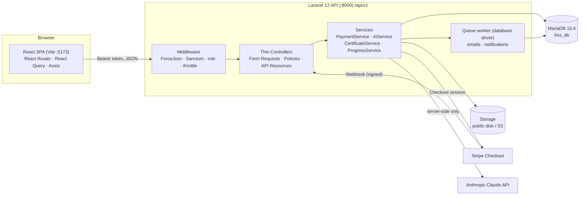
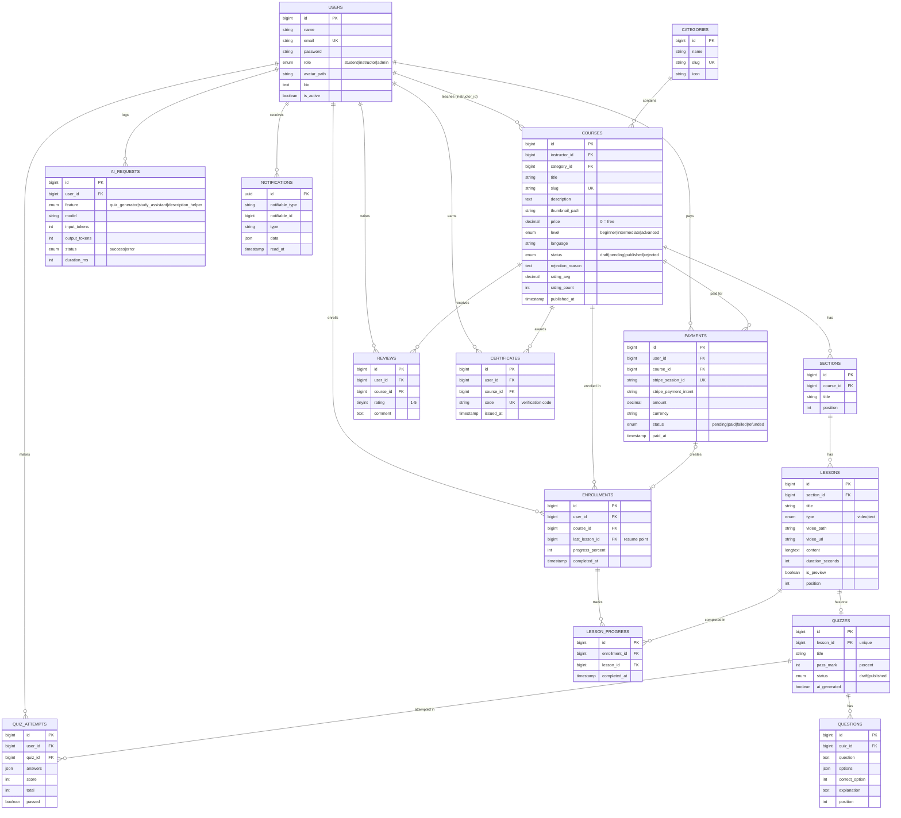

# LearnHub LMS — Architecture

## System overview

Key rules:

- The Claude API key and Stripe secret live only in `backend/.env`. The browser never calls Claude or Stripe's secret APIs directly.
- Every response uses one envelope: `{ success, message, data, errors, meta }` (`App\Support\ApiResponse`).
- Ownership and enrollment are always checked on the server (Policies), never trusted from the client.

## Entity–relationship diagram

Unique constraints: `enrollments(user_id, course_id)`, `lesson_progress(enrollment_id, lesson_id)`, `reviews(user_id, course_id)`, `certificates(user_id, course_id)`, `quizzes(lesson_id)`.

## API modules (`/api/v1`)

| Module | Prefix | Access | Purpose |
|---|---|---|---|
| System | `/health` | Public | API and database status |
| Auth | `/auth/*` | Public / Auth | Register, login, logout, me, forgot/reset password |
| Profile | `/profile/*` | Auth | Update profile, avatar, change password |
| Catalog | `/categories`, `/courses` | Public | Browse, search, filter, sort, course detail |
| Enrollment | `/courses/{course}/enroll`, `/my/courses` | Student | Free enroll, my courses |
| Payments | `/payments/*`, `/webhooks/stripe` | Student / Stripe | Checkout session, history, webhook |
| Learning | `/learn/*` | Enrolled student | Course player, lesson content, mark complete, resume |
| Quizzes | `/quizzes/*` | Enrolled student | Take quiz, submit attempt, attempt history |
| Reviews | `/courses/{course}/reviews` | Public read / enrolled write | Ratings and comments |
| Certificates | `/certificates/*` | Student / Public verify | List, PDF download, verify by code |
| AI | `/ai/*` | Student / Instructor | Study assistant, quiz generator, description helper |
| Instructor | `/instructor/*` | Instructor | Course, section, lesson, quiz CRUD; analytics |
| Admin | `/admin/*` | Admin | Users and roles, course approvals, categories, stats |
| Notifications | `/notifications/*` | Auth | List, mark read |

The full endpoint table and the Postman collection are delivered with the phases that add each module.
